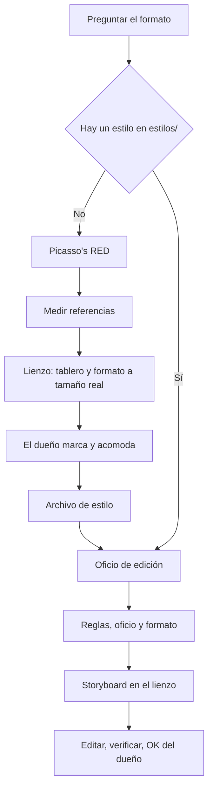

# Picasso's RED y el oficio de edición

Dos skills de Claude Code para editar video con un estilo propio, sin copiar la identidad de otra persona.

**Picasso's RED** (RED = Reverse Engineer Designs) desarma un estilo: pregunta el formato, mide las referencias y no sintetiza hasta que el dueño marca un lienzo. **Oficio de edición** es la puerta para editar: reglas, oficio, formato y el estilo que RED dejó guardado.

El paquete de medición sigue en `scripts/rea/` dentro de Picasso's RED y se importa como `rea`. Renombrarlo rompería los imports y los tests. RED es el nombre del método; `rea` es el nombre del paquete de Python. La variable de los modelos de cara es `REA_MODELOS`.

## Cómo se usan juntas



1. Se pregunta el formato: reel o short 9:16, YouTube 16:9, faceless, motion o explicativo, tutorial con pantalla, anuncio, video largo o clase. Si no está dicho, se pregunta. No se adivina. De ahí salen la resolución y la zona segura.
2. Si no hay estilo, Picasso's RED desarma las referencias. El lienzo (Figma, Wonder, Paper, Excalidraw o el que uses) es obligatorio: tablero de capturas por tipo de escena y formatos dibujados en tamaño real. Si hay un MCP o un conector, se usa. Si no, se exportan las imágenes y una guía para armarlo a mano. Sin lienzo no hay síntesis.
3. Lo aprobado se guarda en `.claude/skills/oficio-de-edicion/estilos/`. Esa carpeta llega vacía, con una plantilla. No trae ningún estilo armado.
4. Para editar un video, el oficio carga las reglas, el formato que toca y un solo estilo. Si falta el estilo, pide Picasso's RED.

## Instalar las dos

En este repo ya están en su sitio. Para otro proyecto de Claude Code:

```bash
mkdir -p .claude/skills
cp -a .claude/skills/picassos-red /ruta/del/proyecto/.claude/skills/
cp -a .claude/skills/oficio-de-edicion /ruta/del/proyecto/.claude/skills/
```

Quedan en `.claude/skills/picassos-red/` y `.claude/skills/oficio-de-edicion/`. Se invocan con «quiero editar como X», «desarma este estilo» o «edita este reel».

Las dependencias de Python hacen falta donde se mide:

```bash
pip install -r requirements.txt
```

En el sistema hacen falta `ffmpeg` y `ffprobe` en el `PATH`. El medidor decodifica con ffmpeg y el volumen lo saca el filtro `ebur128`.

| Paquete | Para qué |
|---|---|
| `numpy`, `scipy` | números, flujo espectral, curvas |
| `opencv-python-headless` | imagen, flujo óptico, detección de cara (YuNet) |
| `scikit-image` | esqueleto del contorno en ilustración |
| `rapidocr-onnxruntime` | texto en pantalla. Si falta, esas métricas salen nulas con su causa |
| `pytest` | la suite de `scripts/rea/tests` |

La primera vez que se miden caras:

```bash
python .claude/skills/picassos-red/scripts/rea/medir.py --descargar-modelos
```

## Qué hay en cada skill

**Picasso's RED** (`.claude/skills/picassos-red/`)

- `SKILL.md`: el método, con el formato al inicio y el lienzo obligatorio.
- `plantilla-desarme.md`, `referencia/`, la spec del medidor y `scripts/rea/`.

**Oficio de edición** (`.claude/skills/oficio-de-edicion/`)

- `SKILL.md`: la puerta. Si no hay estilo, llama a Picasso's RED.
- `reglas.md`: zonas seguras, sonido, movimiento y verificación.
- `oficio/editor/` y `oficio/motion/`: lo que haría cualquier editor con cualquier estilo.
- `formatos/`: reel hablado, faceless, motion, tutorial con pantalla, anuncio y video largo.
- `estilos/`: solo `README.md` y `PLANTILLA.md`. El estilo se crea con RED y se guarda aquí.

El guion de un video tutorial de 8 a 12 minutos está en `docs/guion-tutorial.md`.

## Ejemplo

«Quiero editar como este canal», y el formato todavía no está dicho. La skill pregunta. Si la respuesta es un reel vertical, se reúnen 10 a 20 reels y se mide:

```bash
python .claude/skills/picassos-red/scripts/rea/medir.py ./referencias \
  --salida investigaciones/2026-11-17-estilo/medidas
```

Las capturas van al lienzo, agrupadas por tipo de escena, y el formato 1080×1920 se dibuja con la zona segura. El dueño marca. El estilo queda en `oficio-de-edicion/estilos/`. A partir de ahí, «edita este reel» usa el oficio, el formato de reel hablado y ese estilo.

Los videos de referencia no se commitean: a git van el texto y las medidas. Nunca se genera la cara ni la voz de una persona real sin su permiso.

## Tests

```bash
pip install -r requirements.txt
PYTHONPATH=.claude/skills/picassos-red/scripts pytest .claude/skills/picassos-red/scripts/rea/tests
```

Los tests arman videos sintéticos con ffmpeg y no usan la red. Dos pruebas de cara se saltan si YuNet no está descargado.

## Landing

La página del paquete está en [`landing/index.html`](landing/index.html). Es HTML, CSS y JS sin build. Se abre el archivo en el navegador o se sirve la carpeta `landing/`. No está publicada. El tutorial del hero se vuelve a renderizar desde `video/` con `npm install` y `npm run render`.

## Créditos

El método se inspira en Joseph, en su video sobre el estilo de edición de Arthur Brooks y en su forma de volver un estilo una skill de diseño: si no sabes por qué un estilo funciona, la IA solo ayuda a hacer videos malos más rápido. El vocabulario de composición, equilibrio, contraste, color 60-30-10 y letra sale de sus tips de diseño para editores. El oficio junta principios que haría cualquier editor, separados del gusto de un estilo.
